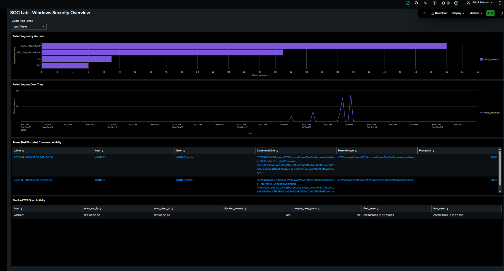
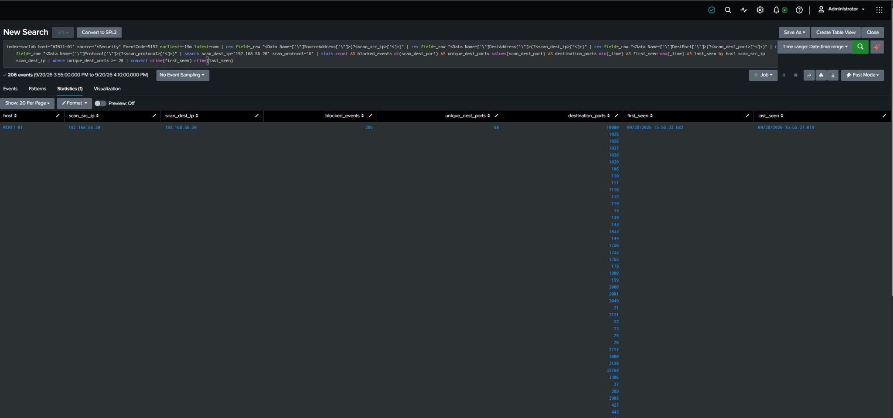
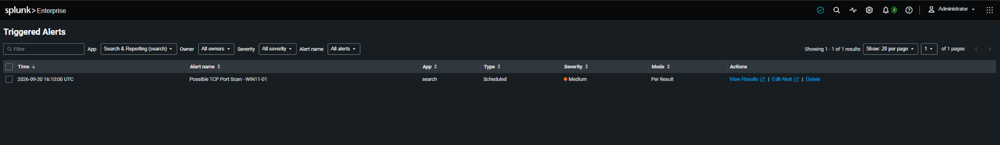

# Windows Telemetry and Splunk Detection Lab

An independent home lab demonstrating Windows log collection, security detections, alert validation, and troubleshooting using Splunk.

## Project objective

Collect Windows security telemetry in one location and test detections for failed logons, encoded PowerShell commands, and possible TCP port scanning.

## Lab environment

- VirtualBox: four virtual machines running Windows Server, Windows 11, Ubuntu Server, and Kali Linux.
- Splunk Enterprise on Ubuntu Server: centralized log searching, scheduled alerts, and dashboards.
- Windows 11: monitored endpoint with Splunk Universal Forwarder and Sysmon.
- Kali Linux and Nmap: controlled network scanning against the Windows lab endpoint.

Verified log collection and detection results described here concern the Windows 11 endpoint.

## What I configured

- Forwarded Windows Security, Sysmon, and PowerShell logs to Splunk using the Universal Forwarder.
- Created three scheduled detections using Splunk Search Processing Language (SPL).
- Built a four-panel dashboard showing failed logons, PowerShell activity, and blocked TCP scan activity.
- Investigated Sysmon collection permissions and search time-range issues.

## Detection scenarios

| Scenario | Evidence used | Validation |
|---|---|---|
| Failed logons | Windows Security Event ID 4625 | Generated failed logons with test accounts and verified the scheduled alert. |
| Encoded PowerShell | Sysmon Event ID 1 and PowerShell Event ID 4104 | Ran a benign encoded command and correlated process creation with script content using process ID and time. |
| Possible TCP port scan | Windows Security Event ID 5152 | Ran an authorized Nmap scan from Kali against the Windows endpoint and verified the scheduled alert. |

## Recorded scan results

One recorded test produced 206 blocked events across 98 distinct destination ports.

Nmap reported 98 filtered ports and two open ports: TCP 135 and TCP 3389. These results describe the controlled lab test and its observed time window.

## Skills demonstrated

- Windows event-log collection and troubleshooting
- SPL search development
- Scheduled alert configuration and validation
- Process and script-event correlation
- Dashboard creation
- Technical documentation

## Scope and limitations

This was a learning environment, not a production SOC. Tests used systems under my control.

Encoded PowerShell and port-scanning alerts identify activity that requires investigation; they do not by themselves prove malicious intent. The PowerShell test was benign, and the scan was authorized.

The detections were validated against specific lab tests. Broader coverage, false-positive tuning, and production readiness were not established.

## Project evidence

### Security monitoring dashboard

The dashboard displays failed logons, failed logons over time,
encoded PowerShell activity, and blocked TCP scan activity.

The selected historical window shows 405 blocked events across
98 distinct destination ports.

### TCP scan investigation

The search results show 206 blocked events across 98 distinct
destination ports, from Kali at 192.168.56.30 to WIN11-01
at 192.168.56.20.

The recorded activity occurred on 20 September 2026 between
15:55:33.682 and 15:55:37.019 UTC.

### Scheduled alert

The "Possible TCP Port Scan - WIN11-01" alert appears in
Triggered Alerts at 16:10:00 UTC on 20 September 2026.

The saved alert results refer to the earlier 15:55 scan.
The alert execution time differs from the event timestamps.

